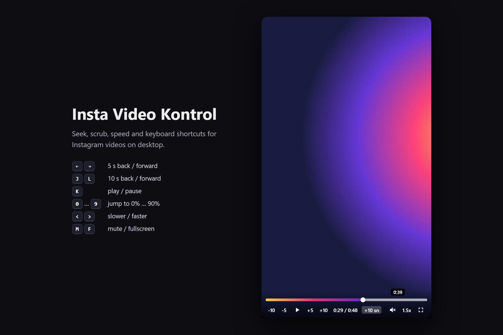

# Insta Video Kontrol

**Seek, scrub, speed and keyboard shortcuts for Instagram videos on desktop.**

Instagram's desktop site plays videos and reels with no seek bar: if you miss a moment, you watch the whole thing again. This small Chrome extension adds a proper control bar on top of every video, plus YouTube-style keyboard shortcuts.

## Features

- **Progress bar**: click or drag anywhere to jump; hovering shows the time under the cursor; the buffered range is shown behind it
- **Seek buttons**: `-10` `-5` `+5` `+10` seconds
- **Play / pause, mute, playback speed** (0.5x to 2x) and **fullscreen** (with Chrome's native controls)
- **Keyboard shortcuts** that do not break Instagram's own navigation
- Built for the feed, reels, post pages, the post modal and stories
- **No permissions, no network requests, no tracking**: a single content script, about 430 lines of plain JavaScript

## Keyboard shortcuts

| Key | Action |
|---|---|
| <kbd>←</kbd> / <kbd>→</kbd> | 5 s back / forward (<kbd>Shift</kbd>: 1 s) |
| <kbd>J</kbd> / <kbd>L</kbd> | 10 s back / forward |
| <kbd>K</kbd> | play / pause |
| <kbd>M</kbd> | mute / unmute |
| <kbd>F</kbd> | fullscreen |
| <kbd>0</kbd> ... <kbd>9</kbd> | jump to 0% ... 90% |
| <kbd>Shift</kbd>+<kbd>,</kbd> / <kbd>Shift</kbd>+<kbd>.</kbd> | slower / faster |

- Arrow keys only seek **while the mouse is over a video**, so Instagram's arrow-key navigation between posts and stories keeps working everywhere else.
- The other keys act on the video under the mouse, or on the most visible video on screen when none is hovered.
- Shortcuts are ignored while you type in a comment box, search field or DM.

## Install

The extension is not on the Chrome Web Store; load it unpacked (takes 30 seconds):

1. Download this repo (**Code > Download ZIP**, then unzip) or `git clone https://github.com/sanwhere/insta-video-kontrol.git`
2. Open `chrome://extensions`
3. Turn on **Developer mode** (top right)
4. Click **Load unpacked** and select the folder that contains `manifest.json`
5. Reload any open instagram.com tab

Works in any Chromium-based browser that supports Manifest V3 extensions (Chrome, Edge, Brave, Opera, Vivaldi).

## How it works

Instagram stacks transparent overlay elements on top of each `<video>` to catch clicks (tap to pause, double-tap to like). That is why simply enabling the native `controls` attribute does not help: the controls are drawn but cannot be clicked.

Instead, the extension:

1. Keeps **one** control bar in a shadow root attached directly to `<html>`, outside Instagram's React tree. Instagram's overlays can never cover it, its styles cannot leak in, and clicks on the bar are stopped before Instagram sees them.
2. On mouse move and scroll, finds the video under the cursor by comparing the pointer with each video's **visible** rectangle (clipped by `overflow: hidden` ancestors and the viewport).
3. While the bar is visible, a `requestAnimationFrame` loop pins it to the bottom of that video and updates time, progress and buffer. When the bar is hidden, nothing runs.

## Notes

- The bar's tooltips and status labels are in Turkish (`sn` = seconds). The controls themselves are icons and numbers.
- Instagram changes its markup often. The extension does not depend on any Instagram class names, only on `<video>` elements, so it should survive most redesigns.
- Not affiliated with, endorsed by or connected to Instagram or Meta.

## License

[MIT](LICENSE)
